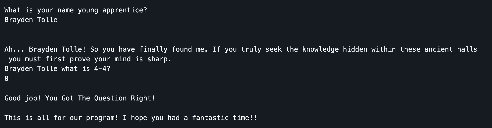
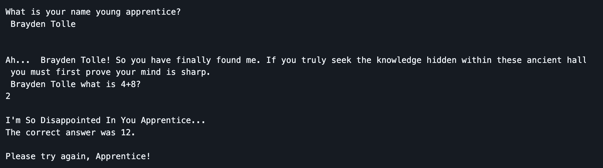
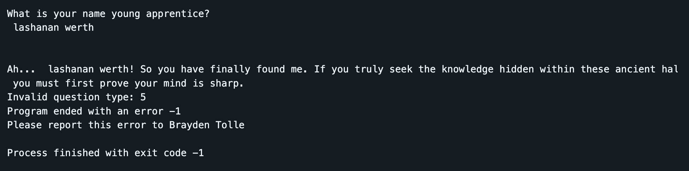
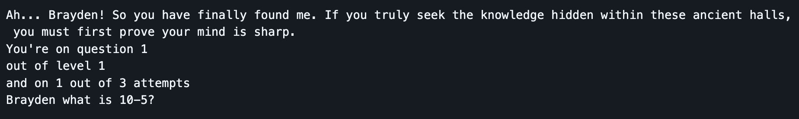
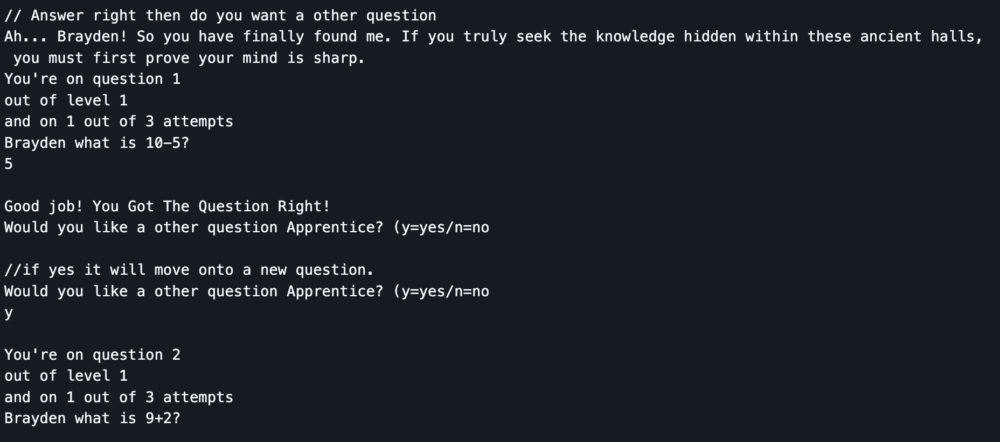
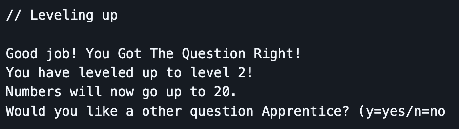
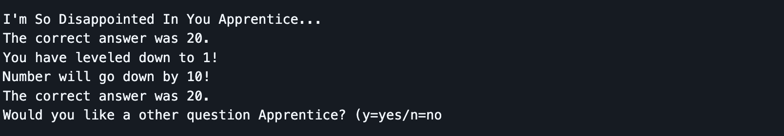
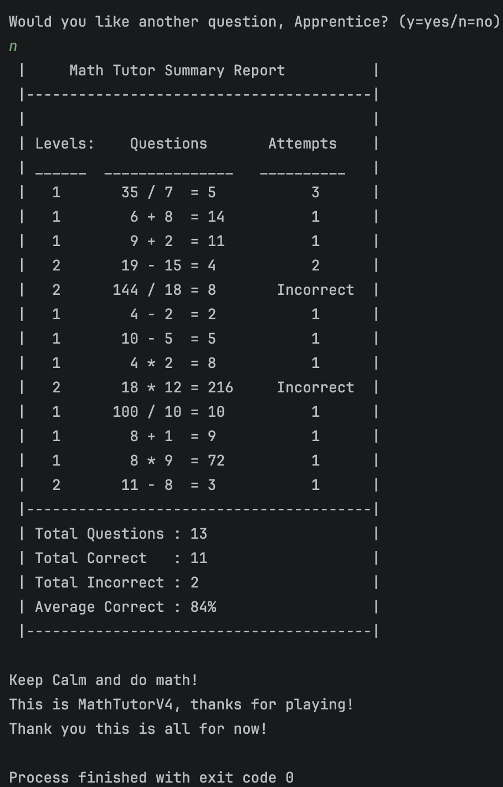
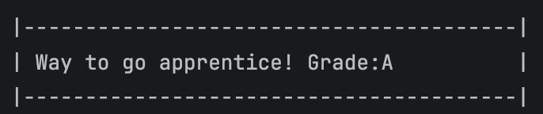

# Math Tutor VI

<b>Table of Content</b>
- [Summary](#summary)
- [Features](#features)
- [Maintainers](#maintainers)
- [New Concepts Used](#new-concepts-used)
- [Console Output Testing Example](#console-output-testing-example)
  - [Right Answer](#right-answer)
  - [Wrong Answer](#wrong-answer)
  - [Invalid Question](#invalid-question)
  - [Displaying level, Questions, and Attempts left](#displaying-level-questions-and-attempts-left)
  - [Asking if user wants another question](#asking-if-user-wants-another-question)
  - [Leveling up](#leveling-up)
  - [Leveling down, and show the correct answer](#leveling-down-and-show-the-correct-answer)
  - [Show the summary report if the user end the program](#show-the-summary-report-if-the-user-end-the-program)
  - [Show the Grade according to the correct score](#show-the-grade-according-to-the-correct-score)
## Summary
Math Tutor V4 is an educational C++ program that presents users with a random math problem and
checks their answer. The program interacts with users by asking for personal information, 
sharing fun math facts, and providing encouraging feedback based on performance. 
The program levels up the player if they get three right answers in a row. If they get 
the answer wrong three times, they go down a level. There will be the detail summary report 
for every question user had during the session. There will also be overall review for 
total questions, correct answer, incorrect answer, and percentage for correct answer. 

## Features
- Displays the wizard themed program header
- Says some magic/wizard jokes
- Gets the user's name and welcomes user
- Displays a random math equation
- Gets the user's answer
- Will determine if the user is right or wrong
- Says goodbye to the user
- Do while loop to run through code for leveling up and down
- Added enum for mathType
- Level up and level down
- Level range to make random go up by 10 or down by 10

## Maintainers
[@Insanedoomed](https://github.com/Insanedoomed) Brayden Tolle  
[@BarnabasHtoo](https://github.com/BarnabasHtoo) Saw Barnabas Thadoe Htoo

## New Concepts Used
- Using 2D Vector to produce the summary report at the end.
- Using single dimension vector to store data.
- Use push_back.
- using #iomanip and setw for align right and left for summary table. 

## Console Output Testing Example
### Right Answer

### Wrong Answer

### Invalid Question

### Displaying level, Questions, and Attempts left

### Asking if user wants another question

### Leveling up

### Leveling down, and show the correct answer

### Show the summary report if the user end the program

### Show the Grade according to the correct score

[Back to Top](#math-tutor-vi)
